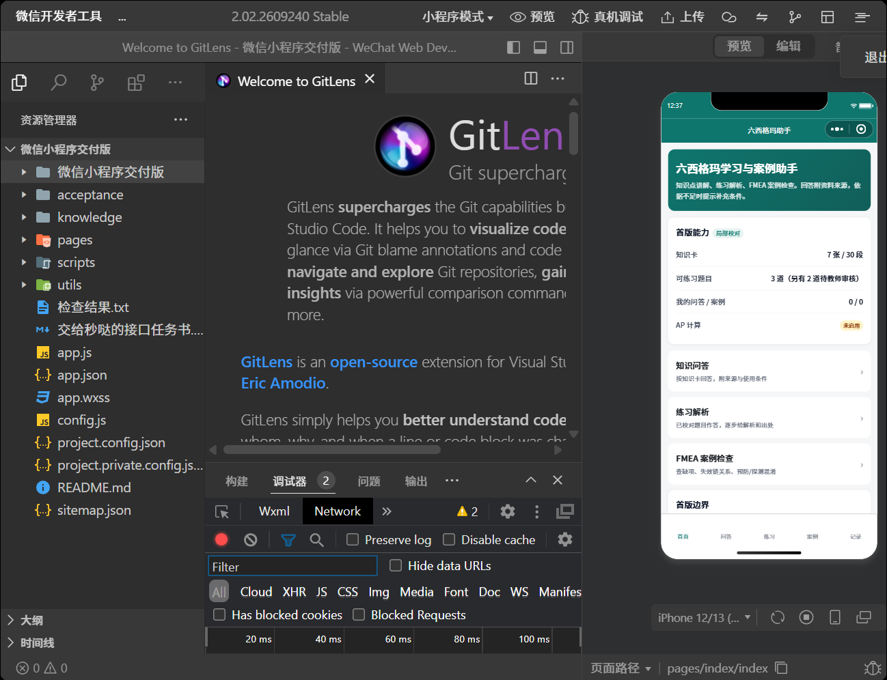
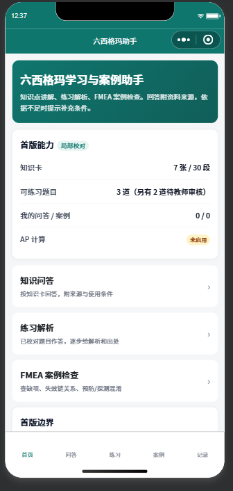
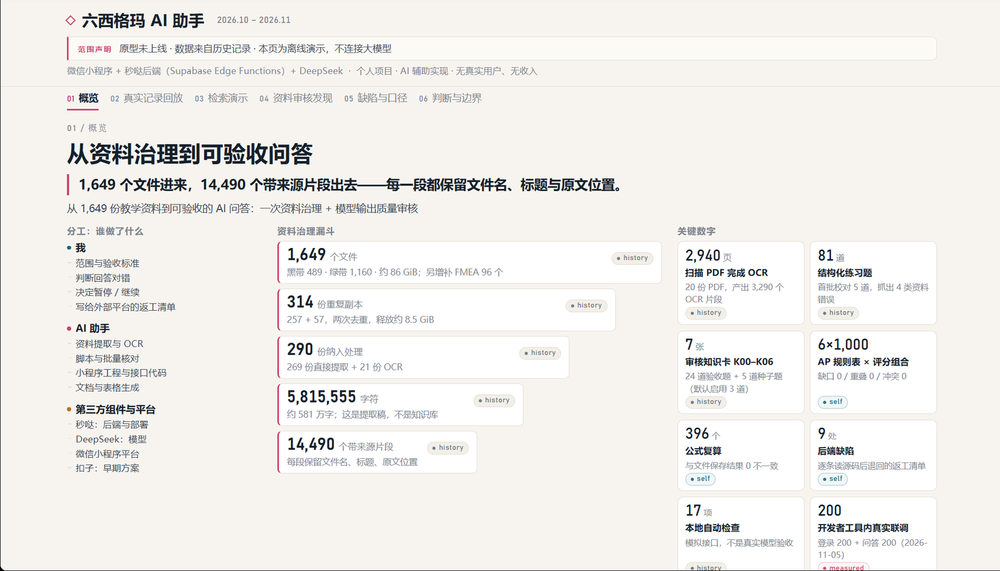
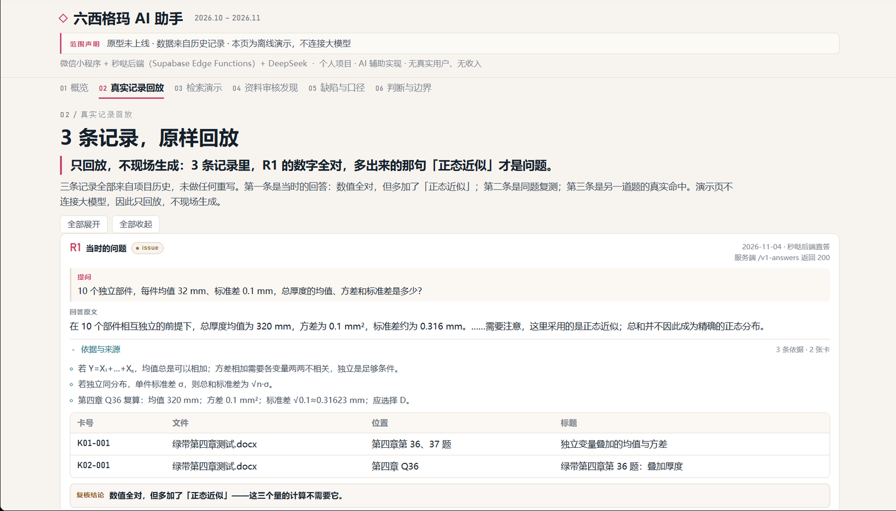
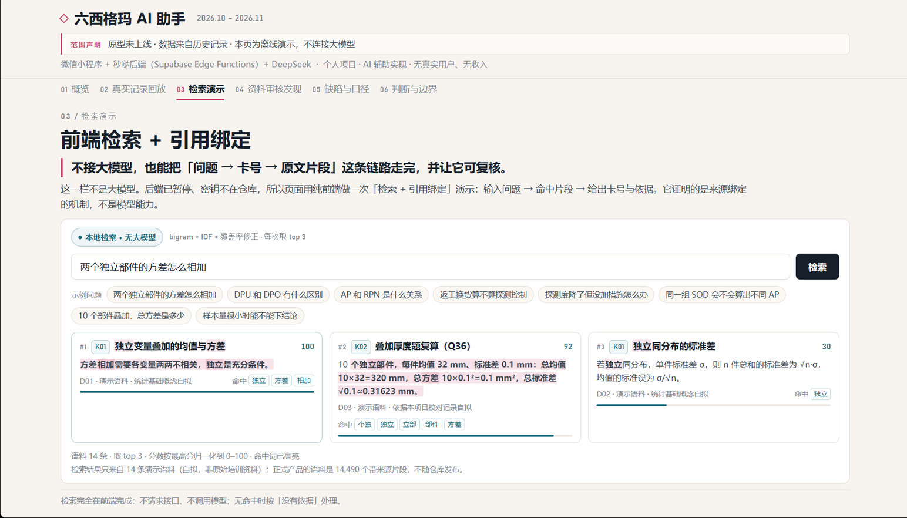
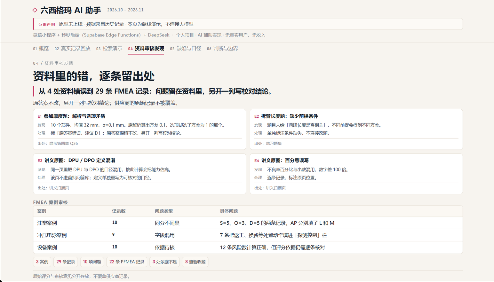
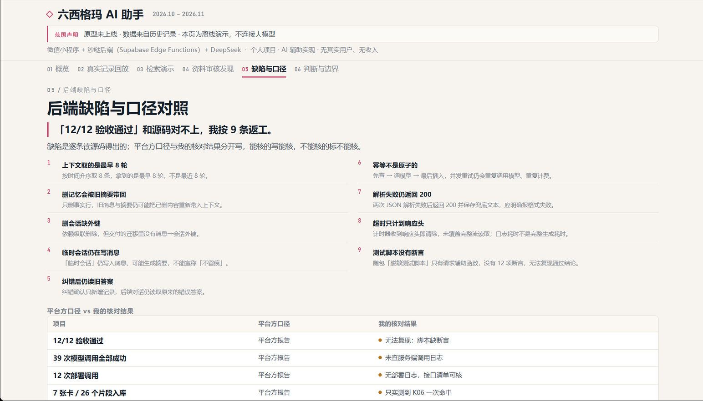
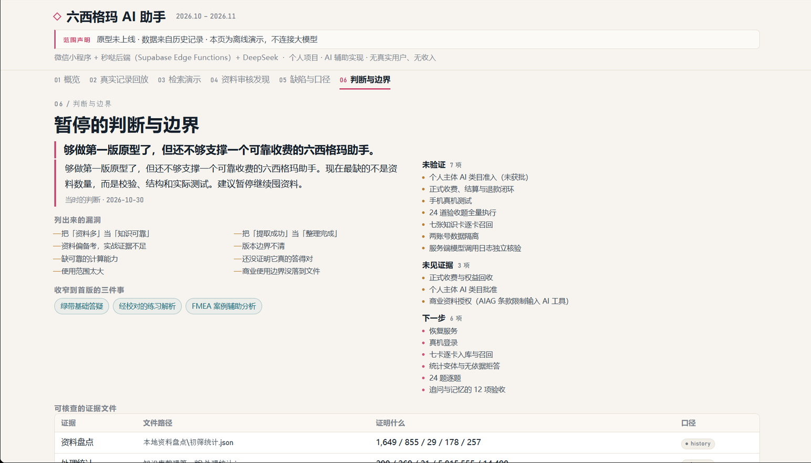

# 六西格玛 AI 助手 · 演示与截图

**在线演示：[ras788997-ship-it.github.io/sixsigma-assistant-portfolio](https://ras788997-ship-it.github.io/sixsigma-assistant-portfolio/)**

一个面向六西格玛绿带/黑带备考与制造业一线改善的 AI 问答助手原型——以及**它为什么还不能上线**的证据。

本仓库只放**演示页 + 截图**，不含产品源码（源码在私有仓库，面试可按需开只读权限）。
公开可见但**未开源**，见 [LICENSE](LICENSE)。

> **状态**：原型 · 未上线 · 未收费 · 无真实用户 · 未取得个人主体 AI 类目准入。
> 仓库不含原始培训资料、教材扫描件、企业案例原文、平台密钥或用户数据。

---

## 一、真实界面（微信开发者工具）

项目在微信开发者工具中运行，5 个页面：首页 / 问答 / 练习 / 案例 / 记录。





首页直接把「能力边界」摆在最上面：知识卡 7 张 / 30 段、可练习题目 3 道（另有 2 道待审核）、**AP 计算未启用**。

---

## 二、演示页：把「怎么验收」做成一页

演示页是离线静态页（零外网依赖），把项目的证据链拆成 6 个板块。下面每张截图对应一个板块。

### 概览：资料治理漏斗



1,649 个文件 → 314 份重复副本清掉 → 290 份纳入处理 → 5,815,555 字符 → **14,490 个带来源片段**。
每个数字都带口径徽章：`我复核过` / `历史整理报告口径` / `平台方自报` / `开发者工具内实测`。

### 真实记录回放：同一道题，前后两个答案



2026-11-04 后端直答「10 个独立部件叠加」，**数值全对，但多加了一句「采用正态近似」**——这三个量的计算不需要它。
2026-11-05 在开发者工具内复测（真实工程 + 真实后端，登录 200 + 问答 200）：320 mm / 0.1 mm² / 约 0.31623 mm，并明确说明不需要正态近似，引用 K01、K02。

### 检索与引用绑定（可交互）



输入问题 → 本地 bigram + IDF 检索 14 条演示语料 → 返回命中片段、卡号、分数并高亮命中词。
**这一栏不是大模型**：后端已暂停、密钥不在仓库，页面用纯前端复现「检索 + 引用绑定」的机制；没命中时它说「没有依据」，而不是编一个答案。

### 资料审核发现：原文的错比模型的错更早



- 叠加厚度题：原解析算出方差 0.1，选项却选了方差 1 → 标「原答案错误，建议 D」，原答案保留不改
- 拆管长度题：缺少「相关性」前提 → 单独标注
- 讲义原图：DPU / DPO 定义混淆、百分号误写 → 不进首批问答库
- FMEA 三份案例 29 条记录里 10 项问题，其中**同样的 S=5、O=3、D=5，AP 却填了一个 L 一个 M**
- AP 规则：6 张表 × 1,000 种组合，缺口 0 / 重叠 0 / 冲突 0；396 个公式复算 0 不一致；但 **4 张 69 行区间表各有 21 行含低于 1 的端点（合计 84 行）** → 计算入口必须限制 1–10 整数

### 「12/12 通过」和源码对不上



平台方报告 12/12 验收通过、39 次模型调用成功；随包的脱敏测试脚本却只有请求辅助函数、没有 12 项断言。逐条读源码后退回 **9 条**：上下文取的是最早 8 轮、删记忆会被旧摘要带回、删会话缺外键、临时会话仍写消息、纠错后仍读旧答案、幂等非原子、解析失败仍返 200、超时只计到响应头、测试脚本无断言。

### 边界与下一步



未验证：AI 类目准入、正式收费与结算、手机真机、24 题全量、七卡逐卡召回、两账号隔离、模型调用日志。
**为什么不上线**：够做第一版原型，但不够支撑一个可靠收费的助手；最缺的不是资料数量，是校验、结构和实际测试。

---

## 三、快速运行

```bat
:: 直接双击，或
python -m http.server 8080
```

页面零外网依赖：无 CDN、无外链字体、无 fetch。断网也能看。
6 个板块各有独立地址：`#/overview` `#/replay` `#/search` `#/audit` `#/defects` `#/boundary`。

---

## 四、我做了什么 / 没做什么

| | 内容 |
|---|---|
| **我** | 定范围与验收标准、判断回答对错、抓住资料本身的错、决定暂停、给外部平台写返工清单与验收题 |
| **AI 助手（Codex / 秒哒）** | 资料提取与 OCR、脚本与批量核对、小程序工程与接口代码、文档生成（AI 辅助实现） |
| **第三方组件与平台** | 秒哒（Supabase Edge Functions 后端与部署）、DeepSeek（模型）、微信小程序平台、扣子（早期方案） |

**不宣称**：独立开发小程序、独立搭建后端、独立训练或微调模型、独立完成 OCR 与知识库工程、有 AI 产品上线运营经验。

---

## 五、口径与边界

| 口径 | 含义 | 例子 |
|---|---|---|
| 我复核过 | 可重跑、能指到文件与行 | AP 规则 6 表 × 1,000 组合、396 公式复算、9 处缺陷 |
| 开发者工具内实测 | 真机链路的一部分，但不是手机 | 登录 200 / 问答 200 / K06 命中 / 320 mm 那组 |
| 历史整理报告口径 | 数字来自当时整理报告，本次未逐页重审 | 1,649 文件、290 份处理、5,815,555 字符、14,490 片段 |
| 平台方自报 | 只能引述，无法独立复现 | 12/12 通过、39 次调用、12 次部署、7 卡 26 片段 |

**未验证 / 未见证据**：个人主体 AI 类目准入、正式收费与结算、手机真机测试、24 道验收题全量执行、七张卡逐卡召回、两账号数据隔离、服务端模型调用日志。
**商业资料授权**：AIAG 条款明确限制将其资料输入 AI 工具，原始资料不随任何仓库发布。

---

## 六、技术要点

- **单页离线演示**：`index.html` + `assets/*`，数据全部在 `assets/demo-data.js`，无构建步骤、无依赖。
- **hash 路由**：任一板块可直接分享。
- **检索演示**：中文 bigram 倒排 + IDF + 覆盖率修正，纯前端，命中词高亮；无命中返回「没有依据」。
- **数字零硬编码**：页面里所有业务数字都从 `demo-data.js` 取。

---

## 许可

**公开可浏览，不开源。** 未应用 MIT / Apache-2.0 / GPL 等任何开源许可，保留全部权利；
阅读代码与截图用于评估作者能力可以，复制、修改、再分发、训练模型不行。详见 [LICENSE](LICENSE)。

第三方名称（六西格玛、AIAG-VDA、FMEA、Minitab、DeepSeek、微信小程序、秒哒、扣子等）归各自权利人所有，仅作事实性指称。
